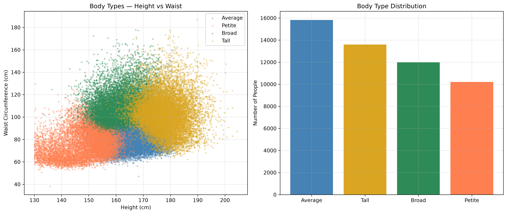

# Body Type Clustering - National Health and Nutrition Examination Survey (NHANES) Dataset.

Discovering natural body type categories in 51,605 U.S. adults using K-Means clustering on physical measurements.

## Overview.

The idea was to make a model that predicts Body type through physical measurements. This project tests whether **unsupervised machine learning can discover natural body type categories** from real physical measurements.

Using CDC's National Health and Nutrition Examination Survey (NHANES) Dataset: "https://wwwn.cdc.gov/nchs/nhanes/default.aspx", I applied K - means clustering 51,605 adult records across 7 physical measurements. The algorithm identified **4 distinct Body Types** - Petite, Average, Broad and Tall.

**Why this matters?:** We can use this model **Body Type Classification** in fit finder to provide size recommendations across a broad range of Body Types.

## Dataset

**Source:** [NHANES Body Measures (BMX)] (https://wwwn.cdc.gov/nchs/nhanes/default.aspx)
- CDC's National Health and Nutrition Examination Survey.

**Cycles:** 1999 - 2002, 2011 - 2023 (7 combined cycles).
**Raw Size:** 66,018 records * 50 columns.
**Cleaned Size:** 51,605 adult records * 7 columns.

**Features used:**
|Feature                 |Description                               |
|          ---           |                 ---                      |
| Height_cm              |Standing Height in centimeters.          |
| Weight_kg              |Body weight in kilograms.                 |
| BMI_kg_m2              |Body Mass Index (kg/m2).                  |
| Waist_Circumference_cm |Waist Circumference in centimeters.      |
| Arm_Circumference_cm   |Mid - Arm Circumference in centimeters.  |
| Arm_Length_cm          |Upper - Arm Length in centimeters.       |
| UpperLeg_Length_cm     |Upper Leg Length in centimeters.         |

## Approach

### 1. Data Collection.
Finding high-quality data was the first major challenge. There are many other datasets but they are all synthetic. I also considered Data Scraping but the problem is that scraped data has too many null values, so I decided to get data from National Health and Nutrition Examination Survey.

### 2. Data Cleaning.
After combining all 7 datasets excluding 2017-March 2020 pre-pandemic (P_BMX) dataset, I started cleaning the dataset.
- I see basic structure of Dataset and renamed columns to understandable variables.
- Dropped non-biological columns (comment columns, admin columns, bp columns, sad raw columns and id columns).
- Dropped 9 more columns containing missing values more than 50%.
- Applied **K - Nearest Neighbours Imputation** (k= 5) to preserve feature relationship and imputed 15% missing data while keeping all 66,018 records before filtering.
- filtered data to Adults only - removed 13,674 children.
- Removed 41 rows with inconsistent BMI records and 698 duplicates.
- final cleaned size 51,605.

### 3. Correlation Analysis.
- Computed pairwise correlations to detect redundant features.
- **Found:** Waist, Weight and Arm_Circumference are highly correlated (>0.85) - they all measure body size.

### 4. Clustering.
- **StandardScaler** normalized features (K-means is distance-based).
- Determined optimal K using **Elbow Method** and **Silhouette Score** (K = 4 found optimal).

### 5. Cluster Interpretation.
- Analyzed per-cluster feature means.
- Named cluster by their statistical profiles (not by arbitrary IDs.)
- **Critical:** Cluster IDs are non-deterministic across runs - names are assigned by feature statistics, not by cluster ID.

## Results

### Discovered Body Types

| Body Type | Count | % | Average Height | Average Waist |
|---|---|---|---|---|
| Average | 15,863 | 30.7% | 165.5 cm | 82.5 cm |
| Tall | 13,829 | 26.8% | 177.5 cm | 103.3 cm |
| Broad | 11,996 | 23.2% | 161.6 cm | 109.8 cm |
| Petite | 9,917 | 19.2% | 148.8 cm | 77.5 cm |

### Clustering Quality

- **Silhouette Score (K=4):** 0.277
- **Interpretation:** Moderate cluster separation — consistent 
  with body composition existing on a continuous spectrum rather 
  than discrete categories

### Visualizations



*Scatter plot showing body type clusters along Height vs Waist axes.*

## Key Findings

1. **Height is the strongest divider.** Two of the four clusters 
   (Petite vs Tall) are separated primarily by height, with 28+ cm 
   between their means.

2. **Waist circumference is a powerful body-size proxy.** It correlates 
   0.91 with BMI — meaning **waist measurement alone accounts for 83% of the variance (r2 = 0.83)** in body size, making it highly effective for size classification.

3. **Body types form a continuous spectrum, not discrete groups.** 
   Silhouette scores (0.28) confirm that body composition doesn't 
   naturally cluster into clean groups. The 4 clusters are 
   *useful simplifications*, not *natural biological categories*.

4. **K-Means cluster IDs are non-deterministic.** Names must be 
   assigned by feature statistics, not cluster ID — otherwise 
   predictions scramble between runs.

## Project Structure.
```text
bodytype-project/
├── README.md
├── requirements.txt
├── project_bodytype.ipynb
├── body_type_visualization.png
├── models/
│   ├── bodytype_pipeline.pkl
│   └── bodytype_labels.pkl
└── data/
    ├── nhanes_bmx_data.csv
    └── nhanes_bodytypes.csv
```
## How to Use?

### Install dependencies.
```bash
pip install -r requirements.txt

```

### Predict Body Type
```python
import joblib
import pandas as pd

# Load models
scaler = joblib.load('models/bodytype_scaler.pkl')
km = joblib.load('models/bodytype_kmeans.pkl')
labels = joblib.load('models/bodytype_labels.pkl')

# Example input: Height, Waist, Arm Length, Leg Length (in cm)
new_person = pd.DataFrame([{
    'Waist_Circumference_cm': 82.5,
    'Height_cm': 165.5,
    'Arm_Length_cm': 36.1,
    'UpperLeg_Length_cm': 39.9
}])

# Scale and predict
scaled_data = scaler.transform(new_person)
cluster_id = km.predict(scaled_data)[0]
body_type = labels[cluster_id]

print(f"Predicted Body Type: {body_type}") # Output: Average

```

## Contact
**Syed Arkaan Ali**
- GitHub: [syed-arkaanali](https://github.com/syed-arkaanali)
- Linkedin: [Syed Arkaan Ali](https://www.linkedin.com/in/syedarkaanali)